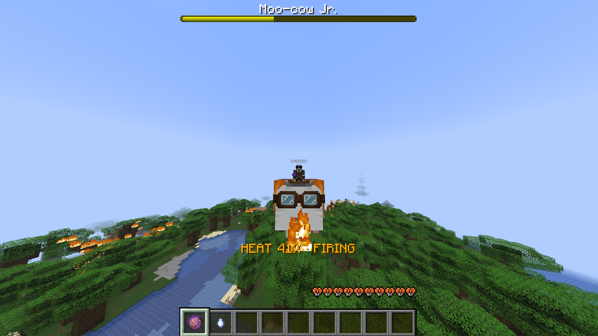
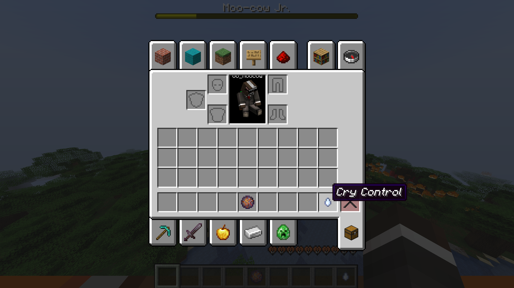
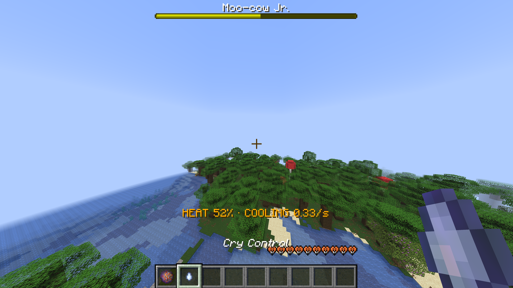
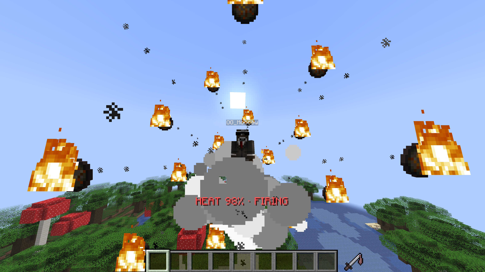

# Happy Artillery

Turn your Happy Ghast into flying artillery. Launch fireballs, make it scream, and try not to blow up your ride.

Made for servers: install it on the server, and players can join without a client mod.

## Take aim

As the pilot, right-click with **Fire Control** to shoot, or hold to keep firing. Use **Cry Control** to make the ghast scream between shots.



Controls appear when you take the pilot's seat. Leave two inventory slots free, then move them wherever you like in your hotbar or offhand. Dismount and ride again to replace a lost control.

*Your controls, your layout.*



## Watch the heat

Every rider can see the heat and cooling rate on the HUD. Fire in bursts, then give your ghast time to cool.



Cold areas and the End cool faster; hot areas cool more slowly. The Nether has no passive cooling by default.

Reach the heat limit and your ghast explodes, scattering fireballs. By default, it doesn't survive. Shots and overheat can damage terrain.

*One shot too many.*



## Configuration

Start the server once to generate `config/happy-artillery.json`, then open it to change controls, firing speed, heat, overheat effects and the HUD.

For example, set `shotCooldownSeconds` under `fire` to `0.5` for half a second between shots, or raise `limit` under `heat` to `150` to allow more heat before overheating:

```json
{
  "fire": { "shotCooldownSeconds": 0.5 },
  "heat": { "limit": 150 }
}
```

This also works as a complete config; omitted settings use their defaults. Save it as valid JSON without comments, then run `/ha reload` as an operator. Invalid settings leave the previous configuration active.

See the [configuration guide](docs/CONFIGURATION.md) for control rules, terrain damage and upgrades, or the [annotated settings reference](docs/happy-artillery-config.jsonc) for every option and default.

## Installation

For **Minecraft 26.3**, use Happy Artillery **1.2.1.1**, **Fabric Loader 0.19.5+**, **Fabric API** and **Java 25+**. For Minecraft **26.2**, use **1.2.0**.

- **Multiplayer:** install Happy Artillery and Fabric API in the server's `mods` folder.
- **Single-player:** install both in your Fabric client's `mods` folder.

**Upgrading?** Remove the old JAR first. See the [upgrade notes](docs/CONFIGURATION.md#upgrading-from-11x) for config migration.

[Modrinth](https://modrinth.com/mod/happy-artillery) · [Report an issue](https://github.com/ff-tech-xyz/happy-artillery/issues) · [Discord](https://discord.gg/tZ6Hx2ETA3) · [PyreHaven](https://pyrehaven.xyz)

## Building from source

```bash
./gradlew build
```

Built JARs are written to `build/libs/`.

[CC0 1.0 Universal](LICENSE) · Made by OG Moo-cow / PyreHaven.
