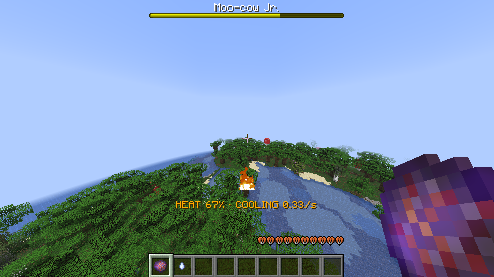
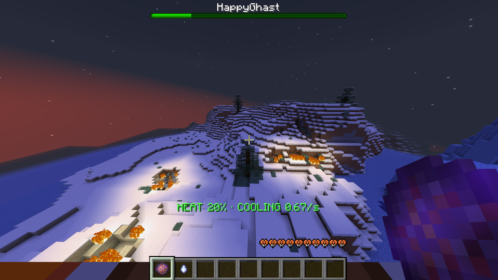

# Happy Artillery

Happy Artillery turns Happy Ghasts into rideable siege machines. The pilot can launch vanilla fireballs, use a Ghast Cry, and risk an overheat by firing too often. Every rider sees the ghast's heat and cooling status.

Happy Artillery runs on the server. Players join with an unmodded Java client.

*A Happy Ghast, a pilot, and fireballs over the forest.*


## Controls

When you become the pilot, the mod gives you one temporary control for each enabled ability:

- **Fire Control:** right-click to fire. Holding the control repeats fire by default.
- **Cry Control:** right-click to play the Happy Ghast's cry. Cry has its own cooldown and does not work while the ghast is touching water.

*Keep an eye on heat and cooling while switching between Fire and Cry.*


The controls need free space in your hotbar or main inventory. Two enabled abilities need two free slots; one enabled ability needs one. If there is not enough room, the mod adds nothing and leaves your existing items alone.

You can move your controls through your hotbar, main inventory, and offhand. Hold a control in either hand to use it. Each control belongs to one player and one ride, so another player cannot use it.

*Put your controls where you want them, not where we left them.*


Dropping a control or moving it into a container, crafting grid, or armor slot consumes it. Controls cannot be stored in bundles, used as crafting ingredients, loaded as ammunition, or used as their underlying vanilla item. A lost control does not return during the same ride; dismount and ride again to receive a new one.

## Heat and overheat

Every Fire shot adds heat. Cold areas and the End add less heat and cool faster. Hot areas add more heat and cool more slowly. The Nether has no passive cooling by default. Water does not cool the ghast.

*Cooling above the forest: 0.33 per second in this scene.*



*Colder air, faster cooling: 0.67 per second over snowy terrain.*



Fire is blocked while the ghast is touching water by default. Server admins can change that with `water.blocksFiring`. Cry is always blocked in water.

The HUD shows when the ghast is firing, not cooling, or cooling at a specific rate. When heat reaches its limit, the configured overheat effects trigger.

`overheat.breaksBlocks` controls the central explosion and direct fire placement:

- `false`: the central explosion does not damage terrain, and the mod does not place fire directly.
- `true`: terrain damage and direct fire placement follow the vanilla `mobGriefing` rule.

The vanilla fireballs emitted during overheat keep their normal impact behavior in either mode.

*Push the heat too far and the whole ride goes up with it.*


## Installation

Requirements:

- Minecraft `26.3`
- Fabric Loader `0.19.5` or newer
- Fabric API
- Java 25 or newer (required by Minecraft 26.3)

Place the Happy Artillery jar and Fabric API in the server's `mods/` folder, then start or restart the server. Clients do not install Happy Artillery.

This source branch builds the Minecraft 26.3 release. Minecraft 26.2 remains supported by Happy Artillery 1.2.0; choose the file matching the server's Minecraft version.

## Configuration

Happy Artillery creates `config/happy-artillery.json` when the file is missing. You can keep the full generated file or provide only the settings you want to override. Valid existing files keep their exact contents during startup and reload.

The [annotated configuration reference](docs/happy-artillery-config.jsonc) lists every setting, default, unit, range, and example. It is documentation only. Do not copy it directly into the runtime config: Happy Artillery reads strict JSON, so comments, trailing commas, duplicate or unknown keys, wrong value types, `null`, arrays, and extra content cause an error.

Admins with gamemaster permission level 2 can apply a valid configuration without restarting:

```text
/ha reload
```

A failed reload reports the problem and keeps the previous working configuration active. It does not replace the invalid file.

### Upgrading from 1.1.x

On startup, Happy Artillery converts a released 1.1.x flat config to the new nested format and saves the exact original file as `config/happy-artillery.json.v1.1.2.bak`. Settings with direct equivalents are carried forward.

Migration stops without changing either file when a customized old setting has no honest replacement. This includes removed ammunition or water-cooling settings and different biome-specific heat limits. Fix the reported setting, then start the server again.

If you used an earlier 1.2.0 development config, replace these old names:

- `heat.firingWindowSeconds` → `heat.coolingDelayAfterShotSeconds`
- `heat.coldMaxTemperature` → `heat.coldBiomeMaxTemperature`
- `heat.hotMinTemperature` → `heat.hotBiomeMinTemperature`
- `heat.unknownDimensionUsesTemperature` → `heat.otherDimensionsUseBiomeTemperature`
- `overheat.fireAttempts` → `overheat.firePlacementAttempts`
- `overheat.fireRadius` → `overheat.firePlacementRadius`

The old names are rejected rather than treated as aliases.

## Building from source

```bash
git clone https://github.com/ff-tech-xyz/happy-artillery
cd happy-artillery
./gradlew build
```

Built jars are written to `build/libs/`.

## License

[CC0 1.0 Universal](LICENSE)

## Credits

- OG Moo-cow, author
- [PyreHaven](https://pyrehaven.xyz)
